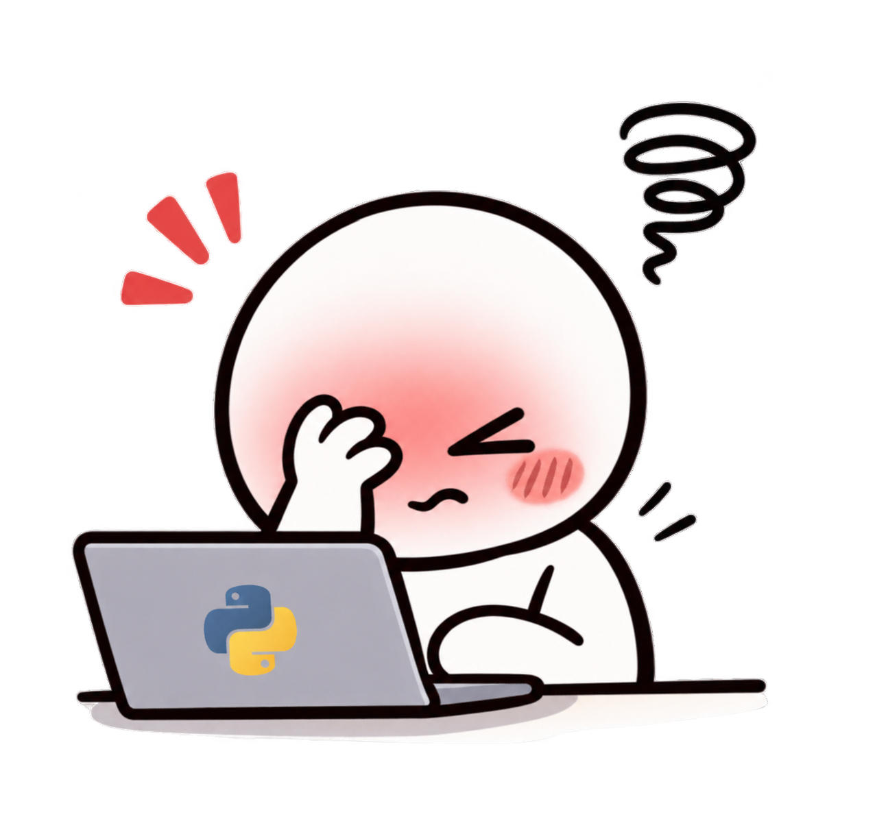

# 🐍 Guia para Iniciantes — 30 Days of Python

  

<h3 align="center">Um passo de cada vez. Um código de cada vez. 💻</h3>

  Bem-vindo(a) à minha jornada pelo Python!

Este espaço nasceu para acompanhar o desafio **30 Days of Python**, desenvolvido por **Asabeneh Yetayeh**.

A ideia é registrar minha evolução desde a preparação do ambiente até os exercícios, experimentos, erros, descobertas e projetos desenvolvidos durante o aprendizado.

Não é necessário ter experiência anterior com programação. Se você também está começando, pode acompanhar essa jornada!

---

## 🚀 Por onde começar?

Existem duas maneiras de acompanhar o desafio:

### 💻 Opção A — Quero apenas estudar

Não precisa ter uma conta no GitHub!

Você vai precisar de:

- Acessar o [repositório original do desafio](https://github.com/Asabeneh/30-Days-Of-Python).
- Baixar ou clonar os arquivos.
- Instalar o Python.
- Instalar o Visual Studio Code.
- Começar a explorar os exercícios.

### 🌱 Opção B — Quero estudar e publicar meu progresso

Além das ferramentas anteriores, você precisará de:

- Uma conta no GitHub.
- Git instalado no computador.
- Um repositório próprio para registrar suas atividades.

Assim, poderá publicar suas soluções, acompanhar seu histórico e construir seu próprio portfólio de aprendizagem.

---

## 🧰 Minha caixa de ferramentas

Estas são as ferramentas utilizadas durante o projeto:

| Ferramenta | Para que utilizo |
|---|---|
| 🐍 Python | Linguagem de programação |
| 💙 Visual Studio Code | Escrever e executar códigos |
| 🔀 Git | Controlar as versões do projeto |
| 🐙 GitHub | Armazenar e compartilhar meu progresso |

---

## 🧭 Como organizei meus estudos

Não quero apenas passar pelos conteúdos. Quero compreender, experimentar e conseguir resolver problemas sem depender de exemplos prontos.

Por isso, organizei minha rotina em ciclos:

📚 <strong>Dois dias de conteúdo novo</strong>

- Leio e observo o conteúdo.
- Compreendo os conceitos apresentados.
- Experimento os exemplos.
- Resolvo exercícios.
- Registro minhas descobertas e dificuldades.

🧠 <strong>Um dia de revisão e fixação</strong>

- Retomo os conteúdos estudados.
- Resolvo exercícios sem consultar exemplos.
- Pratico a construção de códigos.
- Identifico o que já consigo fazer sozinha.
- Reforço os pontos em que ainda tenho dificuldade.

🔁 Depois, o ciclo recomeça com novos conteúdos.

**Uma coisa importante:** não preciso concluir um dia inteiro em uma única sessão. Meu aprendizado acontece no meu ritmo, sem corrida contra o calendário.

---

## 🗺️ Acompanhe minha evolução

Aqui você poderá acompanhar cada etapa do desafio e conhecer um pouco do que acontece nos bastidores do aprendizado.

<blockquote>

### 🚀 [Comece pelo Dia 1](01_Day_Introduction/)

Entre na primeira etapa e acompanhe o início da jornada.

</blockquote>

### 📓 Diário de Soluções

Cada dia terá seu próprio diário, onde registro:

- Os erros que encontrei.
- As tentativas que fiz.
- As pistas que me ajudaram.
- As soluções que descobri.
- O que aprendi com cada dificuldade.

### 🧩 Exercícios de Revisão

A cada dois dias de conteúdo novo, haverá uma pasta dedicada à revisão e à fixação.

Não será apenas uma lista de respostas: também registrarei minhas tentativas, dificuldades e soluções.

---

## 😳 Errar faz parte do código!

  

Nem sempre o código funciona de primeira. Às vezes falta um parêntese, uma variável recebe o tipo errado ou uma ideia que parecia simples acaba dando trabalho.

E está tudo bem!

Quero registrar também esses momentos, porque entender um erro e descobrir como resolvê-lo faz parte de aprender a programar.

**Aqui, os erros não serão escondidos. Serão documentados!** 😂

---

## ✨ O que quero construir com essa jornada?

Mais do que concluir um desafio de 30 dias, quero desenvolver autonomia, raciocínio lógico e confiança para criar meus próprios projetos.

Este repositório será meu registro de evolução: com códigos que funcionaram, outros que deram trabalho e muitas descobertas pelo caminho.

  <strong>Não preciso saber tudo hoje. Só preciso continuar aprendendo. 💜</strong>

---

  🐍 Projeto de aprendizagem — 30 Days of Python

